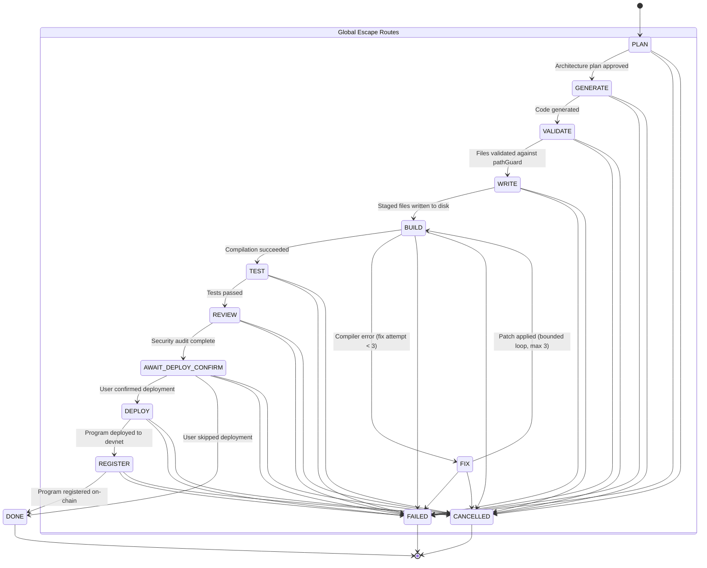

# SolanaPilot Agent Pipeline Specification

This document defines the formal finite state machine (FSM), tool contracts, budget management, and execution lifecycle governing SolanaPilot's end-to-end program generation, building, verification, deployment, and registry workflows.

---

## 1. Pipeline State Graph

---

## 2. Stage Breakdown & Responsibilities

| Stage | Module | Primary Action | Done When |
|---|---|---|---|
| `PLAN` | `stages/plan.ts` | Synthesizes architecture, account schemas, and instruction PDAs from user intent. | Structured plan passes schema validation. |
| `GENERATE` | `stages/generate.ts` | Generates Rust Anchor program code, `Cargo.toml`, and TypeScript integration tests. | Code is generated and passes AST syntax check. |
| `VALIDATE` | `stages/validate.ts` | Validates file paths against `pathGuard` and screens for unsafe patterns. | Target files are within workspace sandbox. |
| `WRITE` | `stages/write.ts` | Safely writes generated code and configuration to disk. | Files are written to disk; workspace is clean. |
| `BUILD` | `stages/build.ts` | Runs `anchor build` using non-shell child process execution. | Compiler exits 0 (`target/deploy/` artifact present). |
| `FIX` | `stages/fix.ts` | Feeds compiler error diagnostic logs to model for targeted diff patch. | Applied patch resolves compiler error (max 3 tries). |
| `TEST` | `stages/test.ts` | Runs Anchor test suite on localnet or devnet. | All tests pass cleanly (exit 0). |
| `REVIEW` | `stages/review.ts` | Executes static security audit checklist (re-entrancy, signer checks, math overflow). | Security checklist scored; recommendations logged. |
| `AWAIT_CONFIRM` | `stages/confirm.ts`| Pauses execution to obtain explicit user confirmation before broadcast. | User confirms or skips devnet deployment. |
| `DEPLOY` | `stages/deploy.ts` | Executes `anchor deploy` under devnet-only safety guard. | Program deployed; on-chain program ID captured. |
| `REGISTER` | `stages/register.ts`| Submits program metadata to SolanaPilot on-chain registry program. | Transaction confirmed; PDA account initialized. |

---

## 3. Toolset Available to the Agent

The ReAct loop (`src/agent/loop.ts`) accesses a strictly typed, permissioned toolset (`src/agent/tools/`):

| Tool | Schema / Arguments | Description | Guard Enforced |
|---|---|---|---|
| `read_file` | `{ path: string }` | Reads text from a workspace file. | `pathGuard` (no `.env*`, no `.git/`) |
| `write_file` | `{ path: string, content: string }` | Creates or overwrites a workspace file. | `pathGuard` (no `*keypair*.json`, no `.git/`) |
| `edit_file` | `{ path: string, target: string, replacement: string }` | Surgically edits a file by exact substring replacement. | `pathGuard` |
| `list_directory`| `{ path?: string }` | Lists directory contents with metadata. | `pathGuard` |
| `execute_command`| `{ command: string, args: string[] }` | Executes approved CLI binaries (`cargo`, `anchor`, `solana`). | No shell interpolation; arg array only |
| `fetch_docs` | `{ url: string }` | Fetches external Solana/Anchor documentation. | `urlGuard` (Strict HTTPS, blocks loopback & private IPs) |
| `inspect_account`| `{ pubkey: string }` | Queries on-chain account info via Solana RPC. | Pubkey validation (32-byte base58) |
| `request_user_input` | `{ question: string }` | Prompts builder in webview for clarification. | Boundary validation |

---

## 4. Run Budget, Receipts, & Cycle Detection

### 4.1 Token & Step Accounting (`src/agent/budget.ts`)
- Each pipeline execution receives a configurable `RunBudget` (default: 50,000 tokens, 20 ReAct steps, 3 compiler fix retries).
- If tokens or steps are depleted before reaching a terminal state, execution stops cleanly with `budget_exhausted`.

### 4.2 Cycle Detection
- The agent loop tracks historical tool call signatures (tool name + hash of arguments).
- If the exact same tool call is invoked 3 times consecutively with failing results, the loop detects a cycle and terminates with `cycle_detected` rather than spinning infinitely.

### 4.3 Execution Receipts (`src/agent/receipts.ts`)
- Upon completion or failure, the pipeline generates a structured, auditable JSON receipt containing:
  - Session and pipeline ID
  - Total elapsed time and tokens consumed (prompt + completion)
  - Full trace of executed stages and applied fixes
  - Deployed program address, transaction signature, and registry PDA (if deployed)
  - Terminal status (`DONE`, `FAILED`, `CANCELLED`)
- Receipts can be exported to disk via the command `SolanaPilot: Export Run Receipt`.
