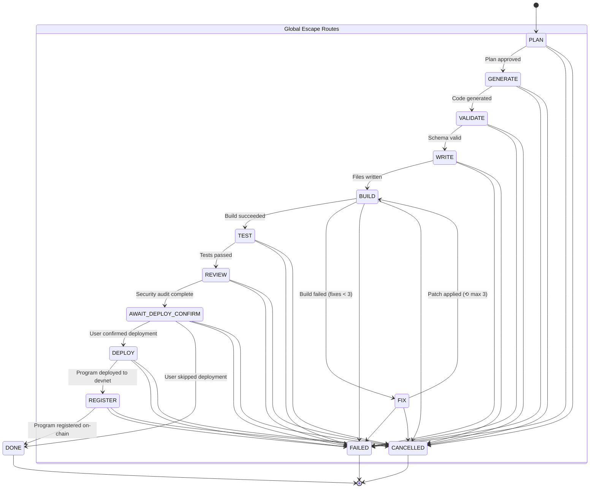

# SolanaPilot Agent Pipeline State Graph

This document defines the formal finite state machine (FSM) governing SolanaPilot's end-to-end program generation, building, verification, deployment, and registry lifecycle.

---

## 1. State Diagram

---

## 2. Stage Definitions

| Stage | Responsibility | Terminal? | Next Legal States |
|---|---|---|---|
| `PLAN` | Generate structured architecture plan (instructions, accounts, PDAs). | No | `GENERATE`, `FAILED`, `CANCELLED` |
| `GENERATE` | Generate Rust program files and Cargo.toml. | No | `VALIDATE`, `FAILED`, `CANCELLED` |
| `VALIDATE` | Enforce strict schema constraints and path guards. | No | `WRITE`, `FAILED`, `CANCELLED` |
| `WRITE` | Staged write to workspace filesystem. | No | `BUILD`, `FAILED`, `CANCELLED` |
| `BUILD` | Execute `anchor build` via `run_check` tool. | No | `TEST`, `FIX` (if fixes < 3), `FAILED`, `CANCELLED` |
| `FIX` | Prompt model for surgical diff patch, apply, and re-test build. | No | `BUILD`, `FAILED`, `CANCELLED` |
| `TEST` | Execute `anchor test` on localnet / devnet. | No | `REVIEW`, `FAILED`, `CANCELLED` |
| `REVIEW` | Run security checklist & static rules over code. | No | `AWAIT_DEPLOY_CONFIRM`, `FAILED`, `CANCELLED` |
| `AWAIT_DEPLOY_CONFIRM` | Await explicit human confirmation before broadcast. | No | `DEPLOY`, `DONE` (skip), `FAILED`, `CANCELLED` |
| `DEPLOY` | Deploy binary to Solana devnet using `execFile`. | No | `REGISTER`, `FAILED`, `CANCELLED` |
| `REGISTER` | Invoke registry on-chain program to publish metadata. | No | `DONE`, `FAILED`, `CANCELLED` |
| `DONE` | Successful terminal state. | **Yes** | None |
| `FAILED` | Unrecoverable error terminal state. | **Yes** | None |
| `CANCELLED` | User or caller cancellation terminal state. | **Yes** | None |

---

## 3. Transition Rules & Invariants

1. **Deterministic Success Path**:
   `PLAN → GENERATE → VALIDATE → WRITE → BUILD → TEST → REVIEW → AWAIT_DEPLOY_CONFIRM → DEPLOY → REGISTER → DONE`

2. **Bounded Fix Loop (Max 3 Fixes)**:
   - When `BUILD` fails, it may transition to `FIX` if and only if `fixCount < 3`.
   - `FIX` transitions strictly back to `BUILD` to verify whether the compiler error was resolved.
   - If the build fails on the 3rd fix attempt (`fixCount === 3`), transition to `FIX` is rejected and the pipeline must transition to `FAILED`.

3. **Global Failure & Cancellation**:
   - `FAILED` and `CANCELLED` are accessible from every active non-terminal state.
   - Terminal states (`DONE`, `FAILED`, `CANCELLED`) cannot transition to any state. Attempting to transition from a terminal state throws `PipelineTransitionError`.

4. **Serialization and Resumption**:
   - The state machine is completely serializable to JSON (`pipeline.toJSON()`) and can be resumed (`PipelineMachine.fromJSON(str)`), storing the full transition history, current stage, fix count, and arbitrary context attributes.

