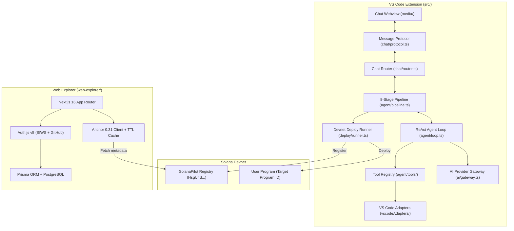
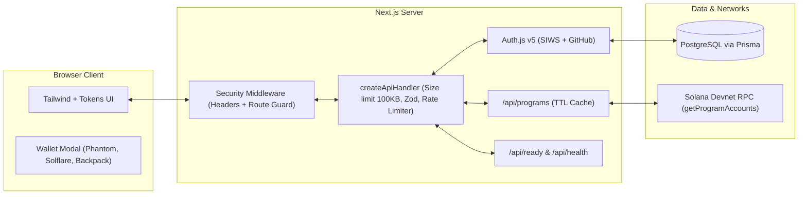

# SolanaPilot System Architecture

SolanaPilot is an AI-assisted development toolkit designed for builders creating Solana programs during hackathons. It automates the full engineering lifecycle: from natural-language specification to code generation, compilation, automated fixing, local testing, security review, devnet deployment, and on-chain registry recording.

---

## 1. System Overview

The system is partitioned into three cooperating subsystems:

---

## 2. VS Code Extension Subsystem

The extension adheres to a strict layered boundary rule: `core/`, `security/`, `ai/`, and `agent/` have **zero** dependencies on the `vscode` module. They operate exclusively through plain TypeScript interfaces and dependency injection.

### Directory Structure & Responsibilities

| Directory | Layer | Purpose & Boundary Constraints |
|---|---|---|
| `src/core/` | Foundation | Typed errors (`AppError`, failure categories), Zod settings schemas, structured logging with redaction, system prereqs. No `vscode` imports. |
| `src/security/` | Security Guards | `pathGuard` (workspace sandbox), `urlGuard` (SSRF filter), `injectionScreen` (jailbreak/override filter), `redact` (secret sanitization). No `vscode` imports. |
| `src/ai/` | Multi-Provider Gateway | Uniform `LlmProvider` contract, structured JSON repair, SDK-free adapters (Anthropic, OpenAI-compatible, Ollama) and Gemini SDK. No `vscode` imports. |
| `src/agent/` | ReAct Engine | Budget enforcement, token accounting, 8-stage pipeline, tool registry, skill loaders, receipts. No `vscode` imports. |
| `src/deploy/` | Deployment | ExecFile-based CLI runner with devnet/localhost safety guards. |
| `src/registry/` | On-Chain Client | Anchor 0.31 TypeScript client for program registration. |
| `src/chat/` | Chat Panel | Webview panel manager, HTML template with CSP, message router, protocol schemas. |
| `src/vscodeAdapters/` | Integration | The single bridge between pure domain logic and VS Code APIs (`SecretStorage`, `OutputChannel`, `Progress`). |

---

## 3. Autonomous Agent Pipeline

The code generation workflow executes as an explicit finite state graph over 8 deterministic stages:

```mermaid
sequenceDiagram
    autonumber
    actor Builder as Hackathon Builder
    participant Chat as Chat Panel
    participant Pipeline as Pipeline Runner
    participant Model as AI Gateway
    participant Tools as Tool Registry
    participant Rust as Cargo / Anchor CLI
    participant Solana as Solana Devnet

    Builder->>Chat: Natural Language Prompt
    Chat->>Pipeline: startPipeline(prompt, options)
    
    rect rgb(30, 30, 35)
        note right of Pipeline: Stage 1: Plan
        Pipeline->>Model: Generate Architecture & Account Layout
        Model-->>Pipeline: Structured Plan (YAML/JSON)
    end

    rect rgb(30, 30, 35)
        note right of Pipeline: Stage 2: Generate
        Pipeline->>Model: Generate Anchor Rust Code + Tests
        Model-->>Pipeline: lib.rs, Cargo.toml, tests
        Pipeline->>Tools: write_file (workspace guarded)
    end

    rect rgb(30, 30, 35)
        note right of Pipeline: Stages 3 & 4: Build & Fix
        Pipeline->>Rust: anchor build
        alt Compilation Error
            Rust-->>Pipeline: Compiler Errors
            Pipeline->>Model: Fix Prompt (Compiler Errors + Code)
            Model-->>Pipeline: Patch
            Pipeline->>Tools: edit_file / write_file
            Pipeline->>Rust: Re-compile (max 3 cycles)
        end
    end

    rect rgb(30, 30, 35)
        note right of Pipeline: Stages 5 & 6: Test & Review
        Pipeline->>Rust: anchor test
        Pipeline->>Model: Run Security Review Checklist
        Model-->>Pipeline: Security Score & Findings
    end

    rect rgb(30, 30, 35)
        note right of Pipeline: Stages 7 & 8: Deploy & Register
        Pipeline->>Solana: Check Devnet Guard & Deploy Program
        Solana-->>Pipeline: Target Program ID & Signature
        Pipeline->>Solana: Register in SolanaPilot On-Chain Registry
    end

    Pipeline-->>Chat: Execution Receipt + Status Summary
    Chat-->>Builder: Finished Program Ready to Run
```

---

## 4. Web Explorer Architecture

The Web Explorer is an independent Next.js 16 application enabling builders and judges to browse on-chain registry submissions.

### Key Components:
1. **SIWS (Sign-In With Solana)**: Cryptographically authenticates wallet ownership via ed25519 detached signature verification (`tweetnacl`) against single-use cryptographic nonces.
2. **Account Linking**: Dual-identity support allowing users to associate both GitHub and Solana wallet credentials with an internal user profile.
3. **Data Layer with Caching**: Server-side proxy querying devnet RPC, caching program metadata in-memory for 30 seconds with parameter clamping ($1 \le \text{pageSize} \le 50$) to protect RPC rate limits.
4. **Reliability & Smoke**: Automated readiness checks (`/api/ready`) monitoring database connectivity, RPC responsiveness, and payload size bounds.

